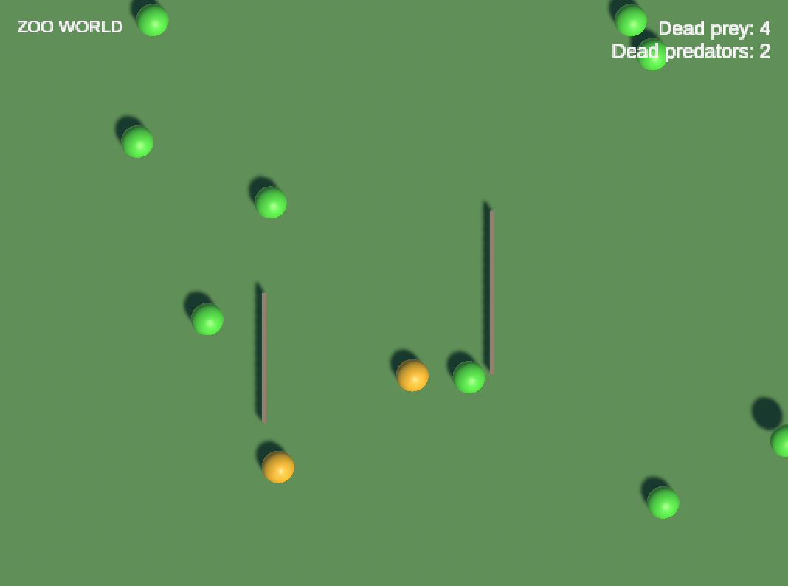

# Zoo World

**Language / Язык:** [English](#english) | [Русский](#русский)

---

## English

A Unity prototype for the "Zoo World" test task: a top-down zoo where
animals spawn on a 1–2 s timer, move and collide through real PhysX, and
predators eat prey. A uGUI HUD shows dead-prey/dead-predator counters and
a "Tasty!" popup under each successful hunt.



The task's main evaluation criterion is the **animal architecture** —
clear, easily extensible code that scales to roughly a thousand species.
This README maps that criterion to the implementation.

- Project: `UnityProject/` (Unity `6000.6.2f1`, the version is fixed in
  `ProjectSettings/ProjectVersion.txt`)

### How the task's criteria are addressed

**Extensible species model (~1000 species).** A species is pure data: an
`AnimalDefinition` asset (ID, statistics role, prefab, spawn weight) plus
a `MovementProfile` and an `InteractionProfile`. Shared systems contain
no species branching (`is Frog`, `switch (type)` are forbidden by
convention). The catalog is unbounded data; the live population is
separately capped by `SimulationSettings` (100 by default), and each
active animal costs O(1) — one pooled object, one strategy instance.

**Movement as Strategy.** `MovementProfile` is an immutable typed
ScriptableObject that creates a fresh plain C# `IMovementStrategy` per
animal activation. Timers, phase and direction live in the strategy,
never in the shared asset — two animals sharing one profile have fully
independent state. `LinearMovementProfile` and `JumpMovementProfile`
cover the initial species; a new movement algorithm is one profile
subclass plus one strategy, not a branch in a central system.

**Food chain as Policy.** `AnimalContactRelay` turns PhysX
`OnCollisionEnter` into backend-neutral `AnimalContact` data.
`AnimalInteractionResolver` normalizes the pair, rejects stale/double
reports, and asks `IAnimalInteractionPolicy` for an `InteractionDecision`
computed from immutable interaction snapshots — no Unity objects, no
mutable state, no `AnimalRole` (that enum exists only for the required
death statistics). Consumption rules are data: a category asset and a
list of edible categories per species.

**DI and patterns.** VContainer 1.19.0 is the only third-party
dependency. `GameLifetimeScope` is the single composition root; services
are plain C# entry points (`IStartable`/`ITickable`), and pooled animals
are injected once via `IObjectResolver` in `AnimalFactory`. No static
`.Instance` singletons, no `FindObjectOfType` in runtime logic, no
service locator. UI follows MVP: passive `IHudView`/`ITastyView` uGUI
views driven by plain C# presenters. Lifecycle is explicit: activation
IDs distinguish pooled lives, death is a one-time `Alive -> Dead`
transition, events fire only after it succeeds.

**No ECS**, per the task constraint. PhysX is the physics backend behind
the narrow `IAnimalMotor` port; strategies never touch Rigidbody APIs.

### Patterns used

| Pattern | Where | What it buys |
|---|---|---|
| Dependency Injection / Composition Root | `GameLifetimeScope` (VContainer), entry points `IStartable`/`ITickable` | Explicit object graph and lifetimes; no static singletons or service locator |
| Strategy | `IMovementStrategy` created by `MovementProfile.CreateStrategy` | New movement algorithms without touching shared systems; per-life state isolated per animal |
| Factory Method | `MovementProfile.CreateStrategy(MovementContext)` | The profile asset picks its strategy — no central switch |
| Policy | `IAnimalInteractionPolicy` → `InteractionDecision` | Food-chain rules are a pure, testable decision separated from contact detection and effects |
| Factory + Object Pool | `AnimalFactory`, `UnityEngine.Pool.ObjectPool<Animal>` | Injection once per instance, explicit per-life reset, bounded reuse |
| MVP | `HudPresenter`/`TastyPresenter` over passive `IHudView`/`ITastyView` | UI logic testable in plain C# EditMode tests; views hold no decisions |
| Observer / typed event bus | `AnimalEventBus` (`AnimalDied`, `AnimalConsumed`) | Decoupled reactions to one-time lifecycle events |
| Immutable snapshot / DTO | `InteractionData`, `AnimalContact`, event payloads | Policies and subscribers never touch mutable pooled objects |
| Adapter / Port | `IAnimalMotor` over Rigidbody, `ISpawnTarget` | Movement code is backend-neutral; PhysX stays behind a narrow interface |
| Data-driven configuration | ScriptableObject definitions/profiles/catalog | Species are assets, validated up front — the ~1000-species growth axis |

### Run

Open `UnityProject` in Unity 6000.6.x and press Play — the startup scene
is `Assets/Scenes/ZooWorld.unity`. Spawning, movement, collisions, the
food chain, HUD counters and the Tasty popup are all live.

### Tests

NUnit via Unity Test Framework: EditMode for pure rules/presenters,
PlayMode for real PhysX contacts, pooling and DI wiring.

Run via the Editor's Test Runner window, or headless in batch mode:

```bash
Unity -batchmode -projectPath UnityProject -runTests -testPlatform EditMode -testResults editmode.xml -quit
Unity -batchmode -projectPath UnityProject -runTests -testPlatform PlayMode -testResults playmode.xml -quit
```

Latest recorded baseline: EditMode 139/139, PlayMode 68/68 — the raw
reports are committed under `docs/test-results/`. The suite was
additionally verified by targeted mutation experiments in isolated
worktrees.

### Performance

A ~270 s development-player run at the 100-animal cap (standalone,
uncapped): ~890 fps, ~1.1 ms main-thread CPU per frame, ~3.6 MB GC heap,
~0 managed allocations per frame, ~380 physics pairs / ~134 contacts /
~106 deaths per second. The instrumentation ships in the runtime:
`SimulationDiagnostics` logs a `[ZooDiag]` line once per second in
development builds, and `-zooworld-prefill=100` pre-fills the population
to the cap. Known cost: a ~2 s spike on the initial burst of 100 pooled
instantiations.

### Build

File > Build Profiles > Build produces a standalone player; the only
scene in Build Settings is `Assets/Scenes/ZooWorld.unity`.

### Limitations and next steps

- The live population is capped at 100 (`SimulationSettings`) — a project
  decision, separate from the unbounded species catalog. Larger crowds
  would need a cheaper backend behind the same `IAnimalMotor` port.
- PhysX is the collision backend, isolated behind
  `AnimalContactRelay`/`IAnimalMotor`; a different backend (including a
  custom solver) can replace it without touching strategies.
- Animals keep their initial random direction until they cross the arena
  edge; per-species wandering would be a new `IMovementStrategy`.
- No audio, persistence or editor tooling (inspectors, gizmos) —
  deliberate scope; catalog validation runs at startup and via context
  menu.

### Adding a species

No code changes for a species built from existing capabilities:

1. Reuse or create a `MovementProfile` asset and an `InteractionProfile`
   (category + edible categories).
2. Reuse a prefab or create a prefab variant.
3. Create an `AnimalDefinition` (unique ID, role, prefab, profiles,
   spawn weight) and add it to `AnimalCatalog`, then validate.

Shipped species: `Frog`/`Snake`/`Hare` under `Assets/Settings/` +
`Assets/Prefabs/Animals/`. Demo species `Turtle` under
`Assets/Tests/PlayMode/Fixtures/` proves the flow — it was added as
assets only, with zero edits to shared systems.

A new movement algorithm = profile subclass + `IMovementStrategy`; a new
food category = assets; a genuinely new interaction (poison, mating) =
new `InteractionDecision` kinds and resolver handling.

Auxiliary tool used: Devin (AI coding agent by Cognition).

---

## Русский

Прототип для тестового задания «Zoo World»: вид сверху на зоопарк, где
животные появляются каждые 1–2 секунды, двигаются и сталкиваются через
настоящую физику PhysX, а хищники едят добычу. HUD на uGUI показывает
счётчики погибшей добычи и хищников, при успешной охоте под хищником
появляется надпись «Tasty!».

Главный критерий оценки задания — **архитектура животных**: понятный,
легко расширяемый код, который масштабируется примерно до тысячи видов.
Ниже — соответствие этого критерия реализации.

- Проект: `UnityProject/` (Unity `6000.6.2f1`, версия зафиксирована в
  `ProjectSettings/ProjectVersion.txt`)

### Как закрыты критерии задания

**Расширяемая модель видов (~1000 видов).** Вид — это чистые данные:
ассет `AnimalDefinition` (ID, роль для статистики, префаб, вес спавна)
плюс `MovementProfile` и `InteractionProfile`. В общих системах нет
ветвления по виду (`is Frog`, `switch (type)` запрещены конвенциями).
Каталог не ограничен кодом; живая популяция отдельно ограничена
`SimulationSettings` (по умолчанию 100), а каждое активное животное
стоит O(1) — один объект из пула и один экземпляр стратегии.

**Движение как Strategy.** `MovementProfile` — неизменяемый типизированный
ScriptableObject, который создаёт новую plain C# `IMovementStrategy` на
каждую активацию животного. Таймеры, фаза и направление живут в стратегии,
а не в общем ассете: два животных с одним профилем полностью независимы.
`LinearMovementProfile` и `JumpMovementProfile` покрывают начальные виды;
новый алгоритм движения — это наследник профиля и стратегия, а не ветка
в общей системе.

**Пищевая цепочка как Policy.** `AnimalContactRelay` превращает PhysX
`OnCollisionEnter` в нейтральные к backend данные `AnimalContact`.
`AnimalInteractionResolver` нормализует пару, отбрасывает устаревшие и
дублирующие отчёты и спрашивает у `IAnimalInteractionPolicy` решение
`InteractionDecision`, вычисленное из неизменяемых снимков данных —
без Unity-объектов, без изменяемого состояния, без `AnimalRole` (этот
enum существует только для требуемой статистики смертей). Правила
поедания — данные: ассет категории и список съедобных категорий у вида.

**DI и паттерны.** VContainer 1.19.0 — единственная сторонняя зависимость.
`GameLifetimeScope` — единственная composition root; сервисы — plain C#
entry points (`IStartable`/`ITickable`), животные из пула получают
зависимости один раз через `IObjectResolver` в `AnimalFactory`. Нет
статических `.Instance`-синглтонов, `FindObjectOfType` в рантайме и
service locator. UI построен по MVP: пассивные uGUI-представления
`IHudView`/`ITastyView` под управлением plain C# презентеров. Жизненный
цикл явный: activation ID различает жизни объекта из пула, смерть —
одноразовый переход `Alive -> Dead`, события публикуются только после
успешного перехода.

**Без ECS** — ограничение задания. PhysX — физический backend за узким
портом `IAnimalMotor`; стратегии не касаются API Rigidbody.

### Используемые паттерны

| Паттерн | Где | Что даёт |
|---|---|---|
| Dependency Injection / Composition Root | `GameLifetimeScope` (VContainer), entry points `IStartable`/`ITickable` | Явный граф объектов и времена жизни; без статических синглтонов и service locator |
| Strategy | `IMovementStrategy`, создаётся через `MovementProfile.CreateStrategy` | Новые алгоритмы движения без правок общих систем; per-life состояние изолировано |
| Factory Method | `MovementProfile.CreateStrategy(MovementContext)` | Профиль-ассет сам выбирает стратегию — без центрального switch |
| Policy | `IAnimalInteractionPolicy` → `InteractionDecision` | Правила пищевой цепочки — чистое тестируемое решение, отделённое от контактов и эффектов |
| Factory + Object Pool | `AnimalFactory`, `UnityEngine.Pool.ObjectPool<Animal>` | Инъекция один раз на объект, явный сброс per-life состояния, ограниченное переиспользование |
| MVP | `HudPresenter`/`TastyPresenter` над пассивными `IHudView`/`ITastyView` | Логика UI тестируется plain C# EditMode-тестами; view не содержит решений |
| Observer / типизированная шина событий | `AnimalEventBus` (`AnimalDied`, `AnimalConsumed`) | Слабосвязанные реакции на одноразовые события жизненного цикла |
| Immutable snapshot / DTO | `InteractionData`, `AnimalContact`, полезные данные событий | Политики и подписчики не касаются изменяемых объектов из пула |
| Adapter / Port | `IAnimalMotor` над Rigidbody, `ISpawnTarget` | Код движения нейтрален к backend; PhysX остаётся за узким интерфейсом |
| Data-driven конфигурация | ScriptableObject-определения/профили/каталог | Виды — это ассеты с валидацией; ось роста на ~1000 видов |

### Запуск

Открыть `UnityProject` в Unity 6000.6.x и нажать Play — стартовая сцена
`Assets/Scenes/ZooWorld.unity`. Спавн, движение, столкновения, пищевая
цепочка, счётчики и «Tasty!» работают.


### Тесты

NUnit через Unity Test Framework: EditMode для чистых правил и
презентеров, PlayMode для реальных PhysX-контактов, пула и DI-разводки.

Запуск — через окно Test Runner в редакторе или в batch-режиме:

```bash
Unity -batchmode -projectPath UnityProject -runTests -testPlatform EditMode -testResults editmode.xml -quit
Unity -batchmode -projectPath UnityProject -runTests -testPlatform PlayMode -testResults playmode.xml -quit
```

Последний зафиксированный baseline: EditMode 139/139, PlayMode 68/68 —
сырые отчёты лежат в `docs/test-results/`. Дополнительно проведены
направленные мутационные эксперименты в изолированных worktree.

### Производительность

Прогон development-плеера ~270 с при лимите в 100 животных (standalone,
без ограничения fps): ~890 fps, ~1.1 мс CPU на основном потоке в кадре,
~3.6 МБ managed-кучи, ~0 управляемых аллокаций в кадре, ~380 физических
пар / ~134 контакта / ~106 смертей в секунду. Инструментация встроена в
рантайм: `SimulationDiagnostics` раз в секунду пишет строку `[ZooDiag]` в
development-билдах, а `-zooworld-prefill=100` заполняет популяцию до
лимита. Известная цена: спайк ~2 с на стартовом burst-инстанцировании 100
объектов пула.

### Сборка

File > Build Profiles > Build собирает standalone-плеер; в Build Settings
только сцена `Assets/Scenes/ZooWorld.unity`.

### Ограничения и дальнейшие шаги

- Живая популяция ограничена 100 (`SimulationSettings`) — решение
  проекта, отдельное от неограниченного каталога видов. Большим толпам
  понадобится более дешёвый backend за тем же портом `IAnimalMotor`.
- PhysX — текущий backend столкновений, изолированный за
  `AnimalContactRelay`/`IAnimalMotor`; другой backend (включая
  собственный solver) заменяет его без правок стратегий.
- Животные держат стартовое случайное направление до выхода за край
  арены; блуждание по виду — это новая `IMovementStrategy`.
- Нет звука, сохранений и editor-инструментов (инспекторы, gizmos) —
  осознанный объём; валидация каталога идёт при старте и через
  context menu.

### Добавление вида

Для вида на существующих возможностях код менять не нужно:

1. Взять или создать ассет `MovementProfile` и `InteractionProfile`
   (категория + съедобные категории).
2. Взять префаб или сделать prefab variant.
3. Создать `AnimalDefinition` (уникальный ID, роль, префаб, профили,
   вес) и добавить его в `AnimalCatalog`, затем провалидировать.

Поставляемые виды: `Frog`/`Snake`/`Hare` в `Assets/Settings/` +
`Assets/Prefabs/Animals/`. Демонстрационный `Turtle` в
`Assets/Tests/PlayMode/Fixtures/` доказывает сценарий — добавлен
только ассетами, без правок общих систем.

Новый алгоритм движения = наследник профиля + `IMovementStrategy`; новая
пищевая категория = ассеты; принципиально новое взаимодействие (яд,
размножение) = новые виды `InteractionDecision` и обработка в resolver.

Использованный вспомогательный инструмент: Devin (ИИ-агент разработки от Cognition).
